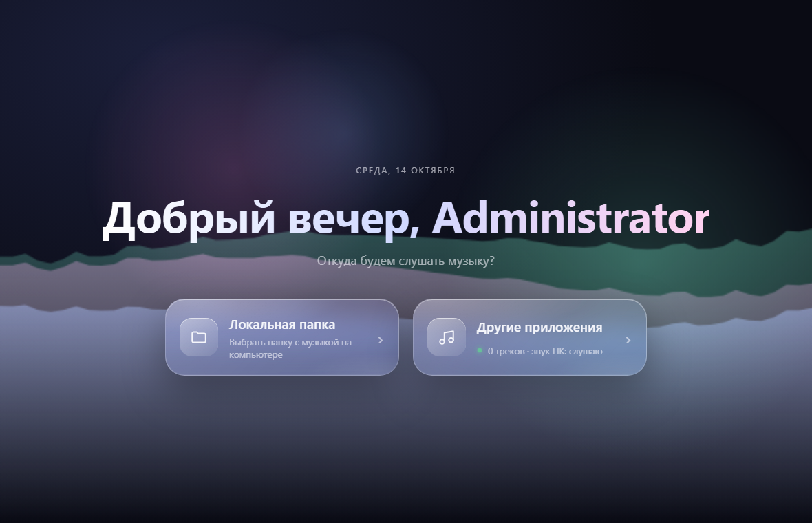
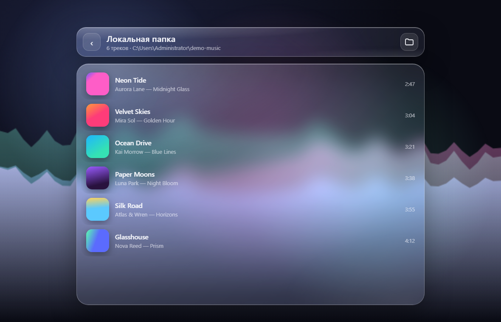
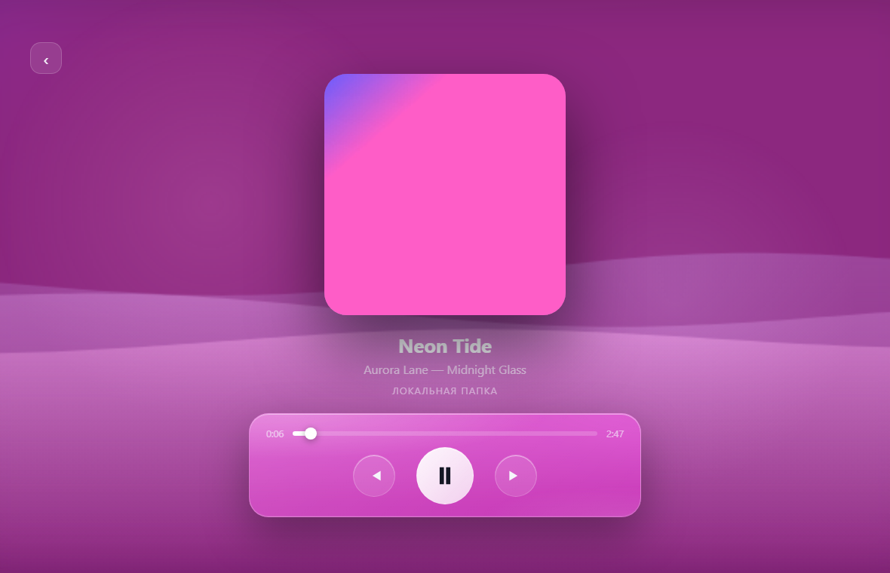
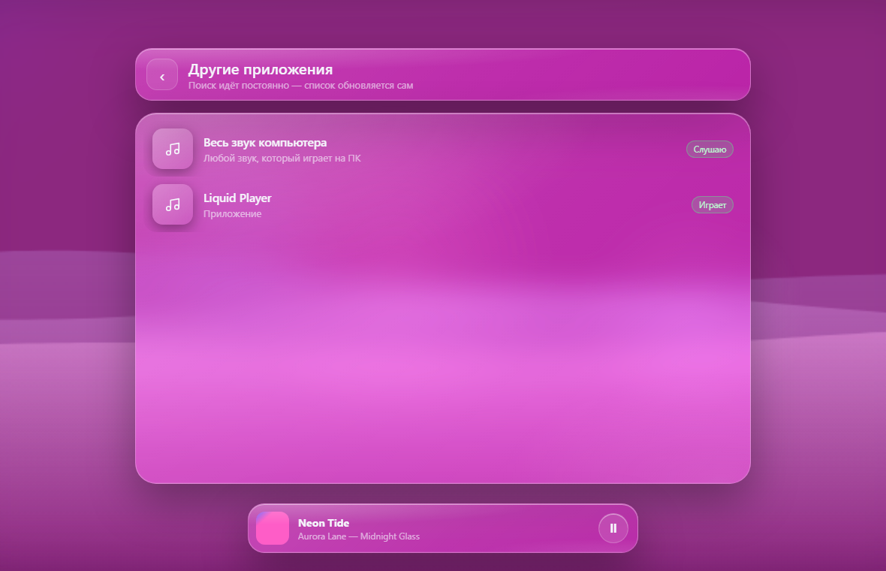

# Liquid Player

Простой музыкальный плеер в стиле iOS liquid glass (Electron).

## Скриншоты





## Возможности
- Приветствие по имени пользователя ПК и времени суток
- Плавная фоновая анимация-визуализатор (Web Audio API), реагирует на музыку
- Источник «Локальная папка»: выбор папки, рекурсивный поиск аудио (mp3, flac, wav, ogg, m4a, aac, opus…), теги и обложки
- Источник «Другие приложения»: постоянный поиск треков, которые играют в других программах (Spotify, браузер, Яндекс Музыка и т.д.), управление ими (пауза / следующий / предыдущий)
- Захват всего системного звука компьютера для визуализатора:
  - Windows: loopback-захват системного вывода
  - macOS 14.2+: запись системного аудио с запросом разрешения; на старых версиях — виртуальный вход BlackHole
  - Linux: монитор PulseAudio / PipeWire
  - Другие приложения: Windows — системные медиа-сессии, Linux — MPRIS через `playerctl`, macOS — Spotify / Music через AppleScript
- Анимация выбора трека: список «утекает» в волны визуализатора, обложка плавно появляется вместе с кнопками, на фоне — размытая обложка

## Запуск
```bash
npm install
npm start
```

Требуется Node.js 22.12+. На Windows должна работать служба «Windows Audio» (на обычных ПК она включена по умолчанию),
иначе система не отдаёт медиа-сессии других приложений.

## Скачать
Сборки для каждой системы публикуются отдельно:
- [Windows](https://github.com/Gitroomcust/liquid-player/releases/tag/vX-windows) — `liquid-player-X-windows-x64-setup.exe` (установщик) и `liquid-player-X-windows-x64-portable.exe` (без установки)
- [macOS](https://github.com/Gitroomcust/liquid-player/releases/tag/vX-macos) — `liquid-player-X-mac-arm64.zip` / `liquid-player-X-mac-arm64.dmg` (Apple Silicon) и `liquid-player-X-mac-x64.zip` / `liquid-player-X-mac-x64.dmg` (Intel)
- [Linux](https://github.com/Gitroomcust/liquid-player/releases/tag/vX-linux) — `liquid-player-X-linux-x64.AppImage`, `.deb` или `.tar.gz`
- [Android](https://github.com/Gitroomcust/liquid-player/releases/tag/vX-android) — `liquid-player-X-android.apk` (Android 7.0+, захват всего звука — Android 10+)

Сборки macOS не подписаны: при первом запуске нажмите правой кнопкой на приложении → «Открыть» или выполните `xattr -cr <путь-к-приложению>`. Захват системного звука доступен на macOS 14.2 и новее.
Релизы собираются GitHub Actions при отправке тега `vX.Y.Z`; публикация нового релиза заменяет предыдущие релизы и теги.

### Android

Скачайте APK и установите его, разрешив установку из неизвестных источников. Для «Весь звук телефона» разрешите запись звука/экрана, а для «Доступ к плеерам» — доступ к уведомлениям.

## Сборка
```bash
npm run dist:linux   # AppImage, deb, tar.gz
npm run dist:mac     # zip и dmg (x64 + arm64)
npm run dist:win     # setup.exe + portable.exe (на Linux нужен wine, напр. образ electronuserland/builder:wine)
```
Артефакты появляются в `dist/`.
